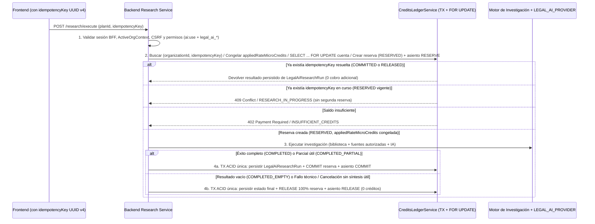

# LEGAL-AI-CREDITS-SPEC-001
## ESPECIFICACIÓN DEL MODELO DE CRÉDITOS Y OPERACIONES FACTURABLES DE IA LEGAL

| Campo | Valor |
| :--- | :--- |
| **Expediente origen** | `LEGAL-AI-RESEARCH-ARCHITECTURE-SPEC-001` |
| **Expediente de reconciliación** | `LEGAL-P0-START-001` *(Fase P0-A)* |
| **Versión** | `v1.2.0` |
| **Estado** | `DOCUMENTACIÓN RECONCILIADA v1.2.0 — PENDIENTE DE APROBACIÓN FORMAL DEL PROPIETARIO` |
| **Aprobación del propietario** | `PENDIENTE` |
| **Fecha** | `2026-11-25` |
| **Autorización de implementación** | `NO AUTORIZADA` *(La aprobación de esta documentación NO constituye autorización de implementación)* |
| **Documentos relacionados (`v1.2.0`)** | [LEGAL-AI-RESEARCH-ARCHITECTURE-SPEC-001.md](./LEGAL-AI-RESEARCH-ARCHITECTURE-SPEC-001.md) · [LEGAL-AI-JURISPRUDENCE-SPEC-001.md](./LEGAL-AI-JURISPRUDENCE-SPEC-001.md) · [LEGAL-AI-NORMATIVE-SPEC-001.md](./LEGAL-AI-NORMATIVE-SPEC-001.md) · [LEGAL-KNOWLEDGE-LIBRARIES-ADR-001.md](./LEGAL-KNOWLEDGE-LIBRARIES-ADR-001.md) · [LEGAL-AI-RESEARCH-IMPLEMENTATION-ROADMAP-001.md](./LEGAL-AI-RESEARCH-IMPLEMENTATION-ROADMAP-001.md) |

### Historial de versiones
| Versión | Fecha | Expediente | Resumen de cambios |
| :--- | :--- | :--- | :--- |
| `v1.0.0` | `2026-11-25` | `LEGAL-AI-RESEARCH-ARCHITECTURE-SPEC-001` | Borrador inicial del modelo de créditos, tablas propuestas e idempotencia. |
| `v1.1.0` | `2026-11-25` | `LEGAL-AI-DOCUMENT-RECONCILIATION-001` | Reconciliación normativa: cierre en diseño de reglas para vacíos (liberación total), parciales útiles (1 cargo estándar), Plan incluido, `microCredits` enteros, tarifa congelada en reserva, ledger append-only con compensaciones, recuperación ante caídas y código independiente para Búsqueda amplia (`DEC-CRED-03`). |
| `v1.2.0` | `2026-11-25` | `LEGAL-P0-START-001` *(P0-A)* | Desdoblamiento explícito de `DEC-CRED-04` en cuatro componentes (`DEC-CRED-04A` desarrollo técnico F1 con fixtures no comerciales, `DEC-CRED-04B` dotación comercial por plan, `DEC-CRED-04C` packs de recarga y `DEC-CRED-04D` migración futura de AUTH-09/10/11). Regla explícita de que las decisiones comerciales de créditos NO bloquean el Programa P0 ni el desarrollo/pruebas técnicas de F1. |

---

## 1. Auditoría del estado actual (Hecho comprobado — READ-ONLY)

> [!IMPORTANT]
> **Resultado de la auditoría:** **NO existe un sistema de créditos implementado en Abogados-Law.**

Evidencia verificada en código y PostgreSQL 18 (`abogados_db`):
- **Tablas existentes pero vacías (`0` filas):**
  - `SubscriptionPlan` (Catálogo global Categoría C, `abogados_app_user` solo `SELECT`): define `maxAiTokens` (tope de tokens, no créditos).
  - `TenantUsage` (RLS `ENABLE + FORCE`): acumula `aiTokensUsed` (entero simple, sin saldo de créditos, sin reservas ni libro mayor).
  - `AIInteraction` (RLS `ENABLE + FORCE`): registra `promptTokens`, `completionTokens` y `costUsd` (hardcodeado en `0` en `UsageControlService`).
- **Servicio legacy parcial:** [usage-control.service.ts](file:///c:/Users/ruben/Documents/Mis-Proyectos/Abogados_law/backend/src/admin/usage-control.service.ts) hardcodea `const LIMIT = 50000` tokens y **no es invocado** por AUTH-09 (`LegalDraftAiService`), AUTH-10 (`LegalAiAssistantService`) ni AUTH-11 (`LegalAiAnalysisService`).
- **Componentes documentados pero inexistentes:** `SubscriptionGuard` mencionado en [docs/SUBSCRIPTIONS.md](./docs/SUBSCRIPTIONS.md) **no existe en código** y se descarta como base del motor de créditos.
- **Inexistentes:** billetera de créditos por organización, libro mayor transaccional inmutable, tarifario configurable de operaciones facturables, motor de reserva/confirmación/liberación, manejo de idempotencia ante reintentos, recuperación ante caídas y conciliación de costos internos vs. créditos consumidos.

---

## 2. Principios de diseño comercial y técnico (Cerrados en diseño)

### 2.1. Separación estricta de conceptos
La arquitectura separa en entidades independientes:
1. **Operación facturable lógica** (`JURISPRUDENCE_AI_RESEARCH`, `JURISPRUDENCE_AI_WIDE_RESEARCH`, `NORMATIVE_AI_RESEARCH`).
2. **Tarifario comercial configurable** (vigente en base de datos, **nunca hardcodeado en servicios**).
   - *Referencia comercial orientativa:* **`≈ 0,4` créditos por búsqueda lógica estándar** *(no fija precios comerciales definitivos sin aprobación)*.
   - **Unidad de almacenamiento obligatoria:** enteros exactos **`microCredits` (`BIGINT`)**, donde **`1 crédito = 10.000 microCredits`** y **`0,4 créditos = 4.000 microCredits`**. *(Cierra en diseño la antigua `DEC-CRED-05`.)*
3. **Costos internos técnicos de IA** (tokens de prompt/completion, modelo por tarea, costo USD real estimado, latencia, cantidad de llamadas internas al proveedor).
4. **Cantidad de fuentes consultadas y resultados recuperados** (telemetría operativa, nunca multiplicador automático de precio).
5. **Reintentos técnicos y estado de ejecución** (nunca multiplican ni duplican el cargo al cliente).

### 2.2. Regla de facturación por operación lógica y no-bloqueo de P0
- **Una búsqueda lógica = una operación facturable.** Una investigación multi-fuente en modo *Automático* se factura como **1 sola operación estándar**, nunca multiplicada por la cantidad de portales consultados.
- **Plan de Investigación incluido (sin segundo cobro):** forma parte de la misma operación lógica (con rate-limit y **0 scraping ni descargas** antes de confirmar). *(Cierra en diseño la antigua `DEC-CRED-02`.)*
- **Búsqueda amplia con código tarifario independiente:** código **`JURISPRUDENCE_AI_WIDE_RESEARCH`** en `CreditOperationCatalog`; su tarifa numérica permanece pendiente (`DEC-CRED-03`) hasta medir costos reales.
- **No bloqueo del Programa P0 ni del desarrollo técnico de F1:** las decisiones comerciales pendientes de créditos (`DEC-CRED-03`, `DEC-CRED-04B/C/D`) **NO bloquean el Programa P0** (reparación gratuita de bibliotecas y Explorador) **ni bloquean el desarrollo y pruebas técnicas de Fase F1** cuando el entorno de pruebas utilice fixtures y cuotas no comerciales explícitas. La **habilitación comercial en producción** sí exige decisiones aprobadas de dotación, precio, cuotas, facturación y condiciones de uso.

### 2.3. Separación estricta entre biblioteca gratuita y consumo premium

| Operación | Consume créditos | Justificación |
| :--- | :---: | :--- |
| Abrir y leer un fallo almacenado en el Explorador (P0) | **NO (`0`)** | Lectura de biblioteca acumulada |
| Abrir y leer una norma o artículo almacenado (P0-E) | **NO (`0`)** | Lectura de biblioteca acumulada |
| Descargar un documento ya incorporado | **NO (`0`)** | Acceso a archivo ya existente |
| Consultar metadatos, historial propio, favoritos o navegar bibliotecas | **NO (`0`)** | Navegación base de la plataforma |
| Recuperación local vía índices FTS o embeddings ya existentes al navegar | **NO (`0`)** | La indexación previa nunca genera cargos adicionales al leer |
| Generar / revisar Plan de Investigación antes de confirmar | **NO (`0`, incluido en operación lógica)** | Permite decisión informada y evita cargos sorpresivos (sujeto a rate-limit) |
| Confirmar y ejecutar **Jurisprudencia con IA** (estándar) | **SÍ (`JURISPRUDENCE_AI_RESEARCH`, ref. `4.000 microCredits`)** | Operación premium (interpretación, búsqueda dirigida, síntesis comparativa) |
| Confirmar y ejecutar **Jurisprudencia con IA — Búsqueda amplia** | **SÍ (`JURISPRUDENCE_AI_WIDE_RESEARCH`, precio pendiente `DEC-CRED-03`)** | Operación premium extendida con código tarifario propio |
| Confirmar y ejecutar **Normativa con IA** | **SÍ (`NORMATIVE_AI_RESEARCH`, ref. `4.000 microCredits`)** | Operación premium (resolución normativa, análisis de vigencia y explicación estructurada) |
| Acción explícita desde AUTH-09/10/11 para disparar nueva investigación premium (Fase G) | **SÍ (solo tras confirmación visible con costo informado)** | Nunca automática ni silenciosa |

---

## 3. Modelo de datos propuesto (Estado: PROPUESTO — NO EXISTENTE)

Todas las tablas por organización deberán tener **`organizationId NOT NULL` + RLS `ENABLE + FORCE`** (AUTH-04) y operar con cantidades enteras en `microCredits` (`BIGINT`):

1. **`CreditOperationCatalog` (Catálogo global de tarifas — Categoría C, `abogados_app_user` solo `SELECT`):**
   - `id`, `operationCode` (`JURISPRUDENCE_AI_RESEARCH`, `JURISPRUDENCE_AI_WIDE_RESEARCH`, `NORMATIVE_AI_RESEARCH`), `costMicroCredits` (`BIGINT NOT NULL CHECK (costMicroCredits >= 0)`), `effectiveFrom`, `effectiveTo`, `isActive`, `description`, `createdAt`, `updatedAt`.
2. **`OrganizationCreditAccount` (Saldo por organización — Multi-tenant con RLS `FORCE`):**
   - `id`, `organizationId` (`@unique`), `availableMicroCredits` (`BIGINT NOT NULL CHECK (availableMicroCredits >= 0)`), `reservedMicroCredits` (`BIGINT NOT NULL CHECK (reservedMicroCredits >= 0)`), `periodStart`, `periodEnd`, `updatedAt`.
3. **`CreditReservation` (Reservas activas y conciliadas — Multi-tenant con RLS `FORCE`):**
   - `id`, `organizationId`, `userId`, `idempotencyKey` (`@@unique([organizationId, idempotencyKey])`), `operationCode`, **`appliedRateMicroCredits`** (`BIGINT NOT NULL` — **tarifa congelada al reservar**, inmune a cambios tarifarios en vuelo), `reservedMicroCredits`, `committedMicroCredits`, `status` (`RESERVED`, `COMMITTED`, `RELEASED`, `EXPIRED`), `researchRunId` (`@unique`), `expiresAt`, `createdAt`, `resolvedAt`.
4. **`CreditLedgerEntry` (Libro mayor estrictamente append-only e inmutable — Multi-tenant con RLS `FORCE`):**
   - `id`, `organizationId`, `userId`, `reservationId`, `entryType` (`GRANT`, `RESERVE`, `COMMIT`, `RELEASE`, `ADJUSTMENT`, `REFUND`), `amountMicroCredits`, `balanceAfterMicroCredits`, `operationCode`, `appliedRateMicroCredits`, `correlationId`, `compensatesEntryId`, `internalAiCostUsd`, `metadata` (no sensible), `createdAt`.
   - **Inmutabilidad estricta:** `INSERT` / `SELECT` exclusivamente; prohibidos `UPDATE` y `DELETE`. Toda corrección o devolución ocurre únicamente vía nuevo asiento compensatorio (`ADJUSTMENT` / `REFUND`).

---

## 4. Ciclo transaccional, idempotencia, concurrencia y recuperación ante caídas

### 4.1. Garantías de idempotencia, concurrencia y recuperación ante caídas
- `UNIQUE(organizationId, idempotencyKey)` + `SELECT ... FOR UPDATE` sobre `OrganizationCreditAccount` dentro de `ScopedPrismaService.runInOrgContext`.
- **Capa 1 (Atomicidad ACID primaria):** escritura del estado final de `LegalAiResearchRun`, transición de `CreditReservation`, actualización de saldo e inserción en `CreditLedgerEntry` dentro de la misma transacción PostgreSQL.
- **Capa 2 (`ReservationReconciliationSweeper`):** ante caídas en vuelo con `expiresAt < NOW()`, bloquea la reserva (`FOR UPDATE SKIP LOCKED`), inspecciona deterministamente `LegalAiResearchRun.status` por `reservationId` y finaliza idempotentemente en `COMMIT` (si hubo resultado útil persistido) o `RELEASE` (si falló, quedó vacío o no existe), protegido por `UNIQUE(reservationId, entryType)` para tipos terminales (`COMMIT`/`RELEASE`).

---

## 5. Reglas definitivas ante fallos, vacíos y resultados parciales (Cerradas en diseño)

| Escenario | Estado de `LegalAiResearchRun` | Regla de créditos cerrada en diseño |
| :--- | :--- | :--- |
| **Plan de Investigación previo a confirmar** | `PLAN_READY` | **`0` créditos adicionales** (incluido en operación lógica; 0 scraping/descargas previas; rate-limit). |
| **Investigación exitosa estándar (1 o múltiples fuentes)** | `COMPLETED` | **1 solo cargo estándar** (`appliedRateMicroCredits`, ref. `4.000 microCredits`). |
| **Investigación Búsqueda amplia** | `COMPLETED` | **1 solo cargo** bajo `JURISPRUDENCE_AI_WIDE_RESEARCH` (tarifa pendiente `DEC-CRED-03`). |
| **Resultado parcial útil** | `COMPLETED_PARTIAL` | **1 solo cargo estándar** (`COMMIT`), indicando explícitamente las fuentes faltantes. |
| **Resultado vacío (`0` precedentes/normas halladas)** | `COMPLETED_EMPTY` | **Liberación total (`RELEASE`, `0` créditos cobrados).** |
| **Error proveedor IA (`502`/`503`), Timeout (`504`), Error DB (`500`), sin fuentes o cancelación sin síntesis útil** | `FAILED` / `FAILED_NO_SOURCES` / `CANCELLED` | **Liberación total (`RELEASE`, `0` créditos cobrados).** |
| **Reintento técnico (misma `idempotencyKey`)** | Deduplicado | **Nunca genera cargos adicionales.** |
| **Ajuste comercial o devolución posterior** | Asiento compensatorio | **Exclusivamente vía nuevo asiento `ADJUSTMENT` / `REFUND`** (nunca `UPDATE`/`DELETE`). |

---

## 6. Relación con telemetría de costos internos

Tabla de observabilidad técnica interna separada del ledger comercial: `correlationId`, `researchRunId`, `operationCode`, `creditsChargedMicroCredits`, `modelUsedByTask`, `promptTokens`, `completionTokens`, `estimatedInternalCostUsd`, `sourcesQueriedCount`, `localCacheHits`, `externalFetches`, `latencyMs` (sin loguear texto jurídico sensible ni credenciales).

---

## 7. Estado de decisiones de créditos (`v1.2.0` — Desdoblamiento de `DEC-CRED-04`)

### 7.1. Decisiones de diseño cerradas *(sujetas a aprobación formal del baseline)*
| ID histórico | Decisión cerrada en diseño |
| :--- | :--- |
| ~~DEC-CRED-01~~ *(Cerrada)* | `COMPLETED_EMPTY` = liberación total (`0` créditos); `COMPLETED_PARTIAL` útil = 1 solo cargo estándar listando fuentes faltantes. |
| ~~DEC-CRED-02~~ *(Cerrada)* | Plan de Investigación incluido en la operación lógica sin segundo cobro (0 scraping/descargas antes de confirmar). |
| ~~DEC-CRED-05~~ *(Cerrada)* | Almacenamiento exacto en enteros `microCredits` (`BIGINT`, `1 crédito = 10.000 microCredits`). |

### 7.2. Separación estricta de `DEC-CRED-04` y decisiones comerciales pendientes
| ID | Alcance | ¿Bloquea P0? | ¿Bloquea desarrollo técnico F1 (con fixtures)? | ¿Bloquea habilitación comercial en producción? | Estado |
| :--- | :--- | :---: | :---: | :---: | :--- |
| **DEC-CRED-04A** | Condiciones técnicas de desarrollo y pruebas de Fase F1 usando fixtures y cuotas no comerciales explícitas. | **NO** | **NO** *(desbloqueado al autorizar F1 técnico)* | N/A | **Cerrado en diseño** |
| **DEC-CRED-04B** | Dotación inicial comercial de créditos por plan (`STARTER`, `PRO`, `ENTERPRISE`), precios, cuotas, facturación y condiciones de uso. | **NO** | **NO** | **SÍ (obligatoria antes de lanzar F1/F2/F3 comercialmente)** | **PENDIENTE DEL PROPIETARIO** |
| **DEC-CRED-04C** | Política comercial y facturación de packs de recarga de créditos. | **NO** | **NO** | **SÍ (para habilitar recargas)** | **PENDIENTE DEL PROPIETARIO** |
| **DEC-CRED-04D** | Eventual migración futura de AUTH-09, AUTH-10 y AUTH-11 al ledger común vs. cupos separados. | **NO** | **NO** | **NO** *(decisión posterior independiente)* | **PENDIENTE DEL PROPIETARIO** |
| **DEC-CRED-03** | Precio numérico exacto de `JURISPRUDENCE_AI_WIDE_RESEARCH` tras medir costos reales en benchmark. | **NO** | **NO** | **SÍ (para habilitar Búsqueda amplia en F2)** | **PENDIENTE DEL PROPIETARIO** |
