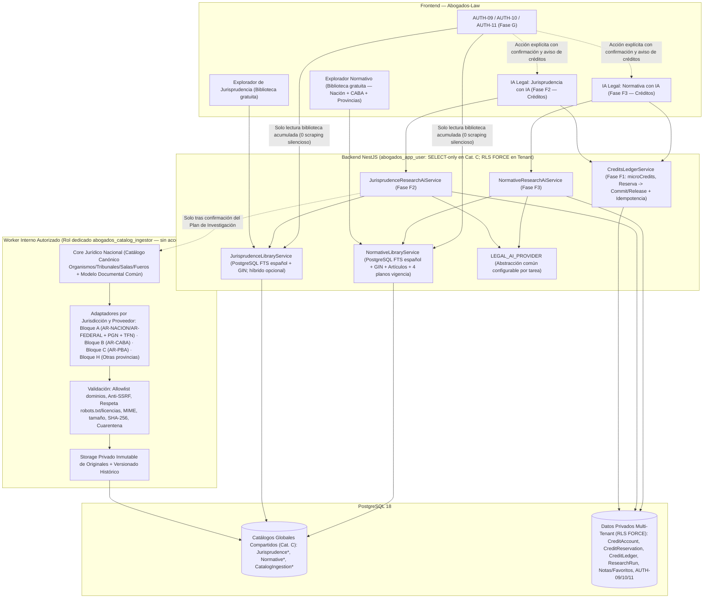

# LEGAL-AI-RESEARCH-ARCHITECTURE-SPEC-001
## ESPECIFICACIÓN FUNCIONAL Y ARQUITECTÓNICA GENERAL — INVESTIGACIÓN JURÍDICA CON IA

| Campo | Valor |
| :--- | :--- |
| **Expediente origen** | `LEGAL-AI-RESEARCH-ARCHITECTURE-SPEC-001` |
| **Expediente de reconciliación** | `LEGAL-P0-START-001` *(Fase P0-A)* |
| **Expediente de enmienda** | `LEGAL-P0-DOCUMENTARY-AMENDMENT-001` *(Micro-enmienda `v1.2.1`)* |
| **Versión** | `v1.2.1` |
| **Estado** | `DOCUMENTACIÓN ENMENDADA v1.2.1 — PENDIENTE DE APROBACIÓN FORMAL DEL PROPIETARIO` |
| **Aprobación del propietario** | `PENDIENTE` |
| **Fecha** | `2026-11-25` |
| **Autorización de implementación** | `NO AUTORIZADA` *(P0-B, F1 ni ninguna fase posterior están autorizadas; la aprobación documental NO constituye autorización de implementación)* |
| **Baseline Git verificado** | Rama `master` — `1d3dc0148d0104e1bff5eeaaf9e098ba85fa739e` |
| **Documentos relacionados (`v1.2.1`)** | [LEGAL-AI-JURISPRUDENCE-SPEC-001.md](./LEGAL-AI-JURISPRUDENCE-SPEC-001.md) · [LEGAL-AI-NORMATIVE-SPEC-001.md](./LEGAL-AI-NORMATIVE-SPEC-001.md) · [LEGAL-AI-CREDITS-SPEC-001.md](./LEGAL-AI-CREDITS-SPEC-001.md) *(`v1.2.0`, sin cambios)* · [LEGAL-KNOWLEDGE-LIBRARIES-ADR-001.md](./LEGAL-KNOWLEDGE-LIBRARIES-ADR-001.md) · [LEGAL-AI-RESEARCH-IMPLEMENTATION-ROADMAP-001.md](./LEGAL-AI-RESEARCH-IMPLEMENTATION-ROADMAP-001.md) |
| **Registros P0-A (`v1.0.1`)** | [LEGAL-P0-SOURCE-VALIDATION-MATRIX-001.md](./LEGAL-P0-SOURCE-VALIDATION-MATRIX-001.md) · [LEGAL-P0-DECISIONS-DEPENDENCIES-MATRIX-001.md](./LEGAL-P0-DECISIONS-DEPENDENCIES-MATRIX-001.md) · [LEGAL-P0-A-EXECUTION-REPORT-001.md](./LEGAL-P0-A-EXECUTION-REPORT-001.md) |

### Historial de versiones
| Versión | Fecha | Expediente | Resumen de cambios |
| :--- | :--- | :--- | :--- |
| `v1.0.0` | `2026-11-25` | `LEGAL-AI-RESEARCH-ARCHITECTURE-SPEC-001` | Borrador inicial basado en auditoría READ-ONLY del repositorio y PostgreSQL 18. |
| `v1.1.0` | `2026-11-25` | `LEGAL-AI-DOCUMENT-RECONCILIATION-001` | Reconciliación integral: desacoplamiento F1/F2/F3, reglas de créditos y `microCredits` cerradas en diseño, triple nivel de verificación jurídica, configuración multi-modelo por tarea sobre proveedor único, aislamiento estricto de investigaciones privadas y endurecimiento de `abogados_catalog_ingestor`. |
| `v1.2.0` | `2026-11-25` | `LEGAL-P0-START-001` *(P0-A)* | Reconciliación P0-A: separación explícita de `DEC-ADR-01` (arquitectura cerrada vs. autorización ejecutiva pendiente `DEC-ADR-01-EXEC`), desdoblamiento de `DEC-CRED-04` (desarrollo técnico F1 desbloqueado vs. habilitación comercial pendiente; créditos no bloquean P0), prioridad jurisdiccional **Bloque A (Nación/Federal CABA + PGN + TFN) + Bloque B (CABA autónoma)** antes que Bloque C (PBA/JUBA) y Bloque H (resto de provincias), y arquitectura Core Jurídico Nacional + adaptadores. |
| `v1.2.1` | `2026-11-25` | `LEGAL-P0-DOCUMENTARY-AMENDMENT-001` | Resolución de `P0-FBA-001`, `P0-FBA-004`, `P0-FBA-005` y `P0-FBA-006`: sincronización explícita de `DEC-P0-BUDGET-01` en §7.2 (aclarando que aplica a gastos en servicios/infraestructura pagos y no convierte el almacenamiento local en gasto), traslado de la cuarentena técnica fail-closed de `ingest-legal-norms.ts` al primer paso técnico de `P0-B`, alineación de `DEC-P0-LEGAL-01` (7 planos / `RESTRINGIDA_POR_ROBOTS_TXT`) y registro de independencia técnica de `F1` respecto de `P0-B` (predecesor AUTH-04, sin autorizar su implementación). |

---

## 1. Propósito y alcance

Esta especificación define la arquitectura funcional, técnica, de seguridad y comercial del **Programa P0 (Reparación de la base jurídica)** y de los dos servicios premium de investigación jurídica de **Abogados-Law**:

1. **Bibliotecas jurídicas gratuitas acumulativas (Programa P0):** Explorador de Jurisprudencia y Explorador Normativo con cobertura nacional progresiva, iniciando por **Bloque A** (`AR-NACION` + `AR-FEDERAL` con asiento en CABA + PGN + TFN) y **Bloque B** (`AR-CABA`: TSJ CABA, JURISTECA y Normativa CABA).
2. **Jurisprudencia con IA (Fase F2):** módulo dedicado dentro de IA Legal.
3. **Normativa con IA (Fase F3):** legislación nacional (`AR-NACION`) y local (`AR-CABA`, con expansión provincial futura) sobre la biblioteca normativa propia.

El diseño garantiza:
- **Core Jurídico Nacional + adaptadores:** núcleo común independiente de jurisdicción, adaptadores por jurisdicción (`AR-NACION`, `AR-FEDERAL`, `AR-CABA`, `AR-PBA` y demás provincias), adaptadores por organismo/proveedor y catálogo canónico de organismos, tribunales, salas, fueros y tipos documentales.
- Evolución incremental sobre el **Explorador de Jurisprudencia** y la base `LegalNorm` ya existentes, **sin crear bibliotecas ni buscadores paralelos** y **sin mezclar nunca la Justicia Nacional ordinaria con asiento en CABA con la Justicia autónoma de CABA**.
- Coherencia estricta con **AUTH-01 a AUTH-11** (sesión BFF, contexto organizacional, RBAC, CSRF, RLS `ENABLE + FORCE`, grants mínimos `SELECT`-only de `abogados_app_user` sobre Categoría C y proveedor desacoplado `LEGAL_AI_PROVIDER`).
- Separación rigurosa entre **lectura gratuita de bibliotecas compartidas acumulativas** y **operaciones premium de investigación con IA facturadas por créditos**.
- **Desacoplamiento comercial y técnico:** las decisiones comerciales de créditos no bloquean el programa P0 ni la reparación gratuita de bibliotecas; F2 (Jurisprudencia con IA) y F3 (Normativa con IA) permanecen desacopladas entre sí.

---

## 2. Estado real verificado del repositorio (Auditoría READ-ONLY)

### 2.1. Funcionalidad existente y verificada
- **AUTH-01 a AUTH-08:** Autenticación BFF (`app_session` HttpOnly + `csrf_token`), `ActiveOrgContextGuard`, `OrgPermissionGuard`, `ScopedPrismaService`, RLS `ENABLE + FORCE` (31 tablas, 124 políticas), clientes, expedientes, movimientos procesales, agenda/vencimientos y gestión documental privada con SHA-256 (`DocumentsManagementService`).
- **AUTH-09 — Generador de Escritos:** `LegalDraftsModule` operativo con `LEGAL_AI_PROVIDER` / `OpenAiLegalDraftingProvider` (`backend/src/legal-drafts/legal-ai.provider.ts`), variables `OPENAI_API_KEY`, `LEGAL_AI_MODEL`, `LEGAL_AI_TIMEOUT_MS`, `LEGAL_AI_MAX_CONTEXT_CHARS`, plantillas, versionado y exportación DOCX/PDF.
- **AUTH-10 — Asistente Jurídico Contextual:** `LegalAiAssistantModule` operativo con `LegalAiContextService` y `DocumentTextExtractorService` (extracción segura DOCX/PDF vía AUTH-08, delimitadores `<UNTRUSTED_*>`, validación de `validSourceIds`).
- **AUTH-11 — Análisis IA de Expedientes:** `LegalAiAnalysisService` y `LegalAiAnalysisController` integrados en `LegalAiAssistantModule`, tabla `LegalAiAnalysis` con RLS `ENABLE + FORCE`, reutilizando `LEGAL_AI_PROVIDER` y `LegalAiContextService`.
- **Contención Categoría C (AUTH-04):** Las tablas globales compartidas `Jurisprudence`, `JurisprudenceChunk`, `JurisprudenceCitation`, `LegalNorm` y `SubscriptionPlan` no tienen RLS por ser catálogos compartidos, y el rol runtime `abogados_app_user` posee exclusivamente `SELECT`. Los endpoints mutantes legacy (`/jurisprudence/import`, `/jurisprudence/ingest`, `/legal/ingest`, `/legal/ingest/batch`, `/legal/version/:normId`) están bloqueados fail-closed mediante `PlatformBlockedGuard` (`403 Forbidden`).

### 2.2. Funcionalidad parcialmente implementada (con defectos verificados)
- **Explorador de Jurisprudencia (`backend/src/ia/jurisprudence/` + `frontend/src/modules/jurisprudencia/`):**
  - Tablas `Jurisprudence`, `JurisprudenceChunk`, `JurisprudenceCitation` existen en `abogados_db` con **0 filas** y **sin columna física `embedding`** (`pgvector` no está instalado ni disponible en PostgreSQL 18.4 local).
  - `GET /jurisprudence/search` y `GET /jurisprudence/stats` fallan contra PostgreSQL 18 real (`column "embedding" does not exist`); `search()` cae silenciosamente en `listAll(limit)` sin filtros.
  - `jurisdiccion` se castea erróneamente a `::"LegalNormJurisdiccion"` aunque la columna es `TEXT`; `EmbeddingService` devuelve vectores `Math.random()` si falta `OPENAI_API_KEY`.
  - Scrapers `csjn.ts` y `formosa.ts` sin tests, sin evidencia funcional actual, sin descarga de PDFs, duplicando sumarios como `textoCompleto`.
  - Frontend con bug `rankingScore * 100` (`10000%`), filtro `CONTENCIOSO` desalineado con `CONTENCIOSO_ADMINISTRATIVO`, XSS vía `dangerouslySetInnerHTML`, y pantalla duplicada legacy rota (`/jurisprudencia/buscar`).
- **Base Normativa (`backend/src/ia/legal/` + tabla `LegalNorm`):**
  - Tabla `LegalNorm` existe en `abogados_db` con **0 filas**, sin columna `embedding` y sin índice Full-Text Search.
  - `GET /legal/search` y `GET /legal/stats` fallan por ausencia de `embedding`/`pgvector`.
  - `LegalIngestionService.createNewVersion` tiene un defecto donde `ingestNorm` sobreescribe `versionNorma: 1`.
  - Script `backend/scripts/ingest-legal-norms.ts` contiene 5 registros con errores jurídicos graves o texto fabricado (**su deshabilitación técnica y cuarentena fail-closed es el primer paso técnico obligatorio de `P0-B`**; el retiro definitivo del modelo `LegalNorm` legacy/migraciones continúa en `P0-E`).
- **Control de uso IA legacy (`UsageControlService`, `TenantUsage`, `AIInteraction`, `SubscriptionPlan`):**
  - Tablas vacías (`0` filas) basadas en conteo de tokens (`aiTokensUsed`, límite hardcodeado `50000`); **no es invocado** por AUTH-09, AUTH-10 ni AUTH-11. `SubscriptionGuard` mencionado en documentación histórica **no existe en código**.

### 2.3. Funcionalidad inexistente
- Core Jurídico Nacional, catálogos canónicos de tribunales/salas/fueros y adaptadores validados para Bloque A, Bloque B, Bloque C y resto de provincias.
- Motor de créditos (`CreditOperationCatalog`, `OrganizationCreditAccount`, `CreditReservation`, `CreditLedgerEntry`, idempotencia y conciliación ante caídas).
- Servicios **Jurisprudencia con IA** (F2) y **Normativa con IA** (F3).
- Almacenamiento persistente inmutable de archivos originales, hashes `SHA-256` activos, versionado de documentos, tablero de cobertura y worker/canal de ingesta controlado bajo `abogados_catalog_ingestor`.
- Integración transversal de las bibliotecas con AUTH-09, AUTH-10 y AUTH-11.

---

## 3. Arquitectura objetivo unificada (Core Jurídico Nacional + Adaptadores)

---

## 4. Frontera estricta entre datos compartidos y datos privados

- **Catálogo global compartido (Categoría C — sin `organizationId`):** una única biblioteca jurisprudencial global y una única biblioteca normativa global. Sin duplicación por organización.
- **Datos privados de cada estudio (Multi-tenant — `organizationId NOT NULL` + `userId` + RLS `ENABLE + FORCE`):** consultas de investigación, planes de investigación, estrategias, notas privadas sobre fallos/normas, favoritos, historial, vínculos con expedientes y libro mayor de créditos.
- **Regla de no contaminación:** las investigaciones privadas, consultas del abogado, notas o selecciones **nunca** se incorporan automáticamente al catálogo global ni se exponen a otras organizaciones.
- **Separación jurisdiccional invariante:** `AR-NACION`, `AR-FEDERAL`, `AR-CABA`, `AR-PBA` y cada jurisdicción provincial se identifican con código canónico propio; nunca se mezcla Justicia Nacional ordinaria con asiento en CABA con la Justicia autónoma de CABA, ni se confunde autoridad judicial con dictamen PGN/PTN o resolución jurisdiccional administrativa TFN.

---

## 5. Matriz de responsabilidades de los módulos de IA Legal

| Módulo | Responsabilidad principal | Fuentes que consume | ¿Lanza scraping externo silencioso? | Facturación / Créditos |
| :--- | :--- | :--- | :---: | :--- |
| **Explorador de Jurisprudencia (P0)** | Navegación, búsqueda textual/filtrada y lectura de la biblioteca jurisprudencial nacional | Biblioteca jurisprudencial global | **No** | **Gratuito (`0` créditos)** |
| **Explorador Normativo (P0-E)** | Consulta de leyes, artículos, historial de versiones y 4 planos de vigencia (`AR-NACION` + `AR-CABA` + expansión provincial) | Biblioteca normativa global (InfoLEG + BOCABA/Digesto/CEDOM) | **No** | **Gratuito (`0` créditos)** |
| **Jurisprudencia con IA (F2)** | Investigación jurídica premium en lenguaje natural, Plan de Investigación, selección inteligente de fuentes y síntesis comparativa verificable | Biblioteca jurisprudencial + worker autorizado tras confirmación del plan | **Nunca silencioso** (requiere confirmación del Plan antes de consultar fuentes externas autorizadas) | **Premium (1 operación lógica; ref. `≈ 0,4` créditos = `4.000 microCredits`)** |
| **Normativa con IA (F3)** | Consulta en lenguaje natural sobre legislación nacional y local, separación texto literal vs. explicación y análisis de vigencia/reformas | Biblioteca normativa global | **No** (sincronización controlada previa; nunca descarga por pregunta) | **Premium (1 operación lógica; ref. `≈ 0,4` créditos = `4.000 microCredits`)** |
| **AUTH-09 — Generador de Escritos** | Redacción y edición asistida de escritos y contratos | Expediente, docs AUTH-08, plantillas + lectura opcional de bibliotecas ya incorporadas (Fase G) | **Nunca** | Acción explícita con aviso de créditos solo si el abogado dispara nueva investigación |
| **AUTH-10 — Asistente Jurídico** | Conversación contextual sobre una causa o consulta profesional | Expediente, movimientos, docs AUTH-08 + lectura opcional de bibliotecas (Fase G) | **Nunca** | Acción explícita con aviso de créditos solo si el abogado dispara nueva investigación |
| **AUTH-11 — Análisis IA** | Informes estructurados sobre expedientes y prueba documental | Expediente, movimientos, vencimientos, docs AUTH-08 + lectura opcional de bibliotecas (Fase G) | **Nunca** | Acción explícita con aviso de créditos solo si el abogado dispara nueva investigación |

---

## 6. Política de modelo de IA, infraestructura y costos

1. **Proveedor único desacoplado configurable por tarea:** Reutilizar la abstracción `LEGAL_AI_PROVIDER` (`OpenAiLegalDraftingProvider`) extendida para soportar selección/configuración de **modelos distintos por tipo de tarea** bajo una misma interfaz común, sin crear clientes paralelos innecesarios.
2. **Benchmark obligatorio antes de fijar modelo definitivo (`DEC-ARCH-02`):** evalúa calidad de razonamiento jurídico, fidelidad literal de citas, calidad de síntesis estructurada, detección de criterios divergentes, latencia extremo a extremo y costo interno real por investigación. **Principio rector:** *la calidad jurídica tiene prioridad sobre minimizar el costo a cualquier precio.*
3. **Motor de búsqueda base obligatorio:** PostgreSQL Full-Text Search en español (`tsvector` + `unaccent` + índices GIN) + filtros estructurados exactos. **No depende de `pgvector` ni de APIs de IA para la búsqueda básica.**
4. **Prohibición de vectores artificiales:** Queda terminantemente prohibido generar vectores aleatorios o sintéticos (`Math.random()`).
5. **`pgvector` como ampliación opcional:** Desacoplado y sujeto a disponibilidad real de infraestructura y benchmark posterior.
6. **Observabilidad y presupuesto operativo:** Registro interno de tokens, latencia, modelo por tarea, costo USD real, aciertos de caché/biblioteca local vs. consultas externas y control de concurrencia/rate-limits por proveedor (sin loguear texto jurídico sensible ni credenciales).

---

## 7. Consolidación de decisiones cerradas vs. autorizaciones y decisiones pendientes (`v1.2.1`)

*(Ver matriz completa y trazabilidad en [LEGAL-P0-DECISIONS-DEPENDENCIES-MATRIX-001.md](./LEGAL-P0-DECISIONS-DEPENDENCIES-MATRIX-001.md).)*

### 7.1. Decisiones arquitectónicas y de diseño cerradas en el baseline `v1.2.1` *(NO equivalen a autorización de implementación)*
- **Core Jurídico Nacional + adaptadores** por jurisdicción y proveedor con prioridad de primer bloque **Bloque A (Nación/Federal CABA + PGN + TFN) + Bloque B (CABA autónoma)**, seguido por **Bloque C (PBA/SCBA/JUBA)** y **Bloque H (otras provincias)**.
- **Bibliotecas globales compartidas únicas (Categoría C)** con datos de investigación privados aislados por RLS `FORCE`.
- **`DEC-ADR-01` (Parte A — Diseño arquitectónico cerrado):** `abogados_app_user` estrictamente `SELECT`-only sobre Categoría C; escritura exclusiva vía worker interno con `abogados_catalog_ingestor` sin `SUPERUSER`, `BYPASSRLS`, `CREATEROLE`, `CREATEDB`, DDL ni acceso a tablas multi-tenant y sin rutas HTTP públicas. *(Su creación física en PostgreSQL permanece pendiente de autorización ejecutiva `DEC-ADR-01-EXEC`.)*
- **PostgreSQL FTS español + GIN** como motor base; `pgvector` opcional; prohibición de vectores sintéticos.
- **Triple nivel de verificación jurisprudencial**, clasificación diferenciada de autoridad (judicial vs. dictamen PGN/PTN vs. TFN) y **separación de 4 planos + 9 hitos temporales** en vigencia normativa (`UNKNOWN_UNVERIFIED` por defecto; variantes textuales `ORIGINAL | UPDATED | CONSOLIDATED`).
- **Cuarentena técnica fail-closed de `backend/scripts/ingest-legal-norms.ts`** establecida como **primer paso técnico obligatorio de `P0-B`** (retiro definitivo del modelo `LegalNorm` legacy/esquema en `P0-E`).
- **Reglas de créditos cerradas en diseño:** 1 operación lógica = 1 cargo (ref. `≈ 0,4` créditos = `4.000 microCredits` enteros `BIGINT`), ledger append-only inmutable con compensaciones, tarifa congelada en reserva, recuperación ante caídas, liberación total en vacíos/fallos, 1 cargo estándar en parciales útiles, 0 cobro en bibliotecas/Plan/reintentos.
- **Desacoplamiento comercial y técnico:** las decisiones comerciales de créditos no bloquean P0 ni el desarrollo técnico de `F1` con fixtures no comerciales; además, **`F1` técnico es independiente de `P0-B`** y depende técnicamente de **AUTH-04** *(sin que esta independencia técnica autorice implementar `F1`)*.

### 7.2. Autorizaciones ejecutivas y decisiones abiertas (requieren decisión del propietario)
| ID | Tipo | Descripción pendiente | Documento principal |
| :--- | :--- | :--- | :--- |
| **DEC-IMPL-P0B** | Autorización ejecutiva | Aprobación del baseline `v1.2.1` y autorización expresa posterior para iniciar **P0-B** (cuarentena script legacy + reparación del modelo documental y del Explorador). | [LEGAL-AI-RESEARCH-IMPLEMENTATION-ROADMAP-001.md](./LEGAL-AI-RESEARCH-IMPLEMENTATION-ROADMAP-001.md) |
| **DEC-ADR-01-EXEC** | Autorización ejecutiva | Autorización expresa para crear físicamente el rol PostgreSQL `abogados_catalog_ingestor` y configurar sus privilegios mínimos en `P0-B` *(diseño arquitectónico cerrado; creación NO autorizada en P0-A)*. | [LEGAL-KNOWLEDGE-LIBRARIES-ADR-001.md](./LEGAL-KNOWLEDGE-LIBRARIES-ADR-001.md) |
| **DEC-ADR-02 / 03** | Decisión técnica/infra | Backend de almacenamiento privado de originales (`KNOWLEDGE_STORAGE_ROOT` local sin costo adicional vs. S3) y política de retención/TTL. | [LEGAL-KNOWLEDGE-LIBRARIES-ADR-001.md](./LEGAL-KNOWLEDGE-LIBRARIES-ADR-001.md) |
| **DEC-P0-LEGAL-01** | Decisión jurídica | Evaluación diferenciada en 7 planos (condiciones de uso, licencia, Ley 11.723, Ley 25.326, restricciones contractuales y eventuales convenios institucionales) para fuentes `RESTRINGIDA_POR_ROBOTS_TXT` (Buscador Tribunales Nac./Fed. CSJN, JURISTECA, descarga web PDF SAIJ) o `VIABLE_CON_CONDICIONES` sin licencia abierta verificada (Tomos Fallos CSJN, PGN, TFN, TSJ CABA, BOCABA/Digesto). | [LEGAL-P0-SOURCE-VALIDATION-MATRIX-001.md](./LEGAL-P0-SOURCE-VALIDATION-MATRIX-001.md) |
| **DEC-NORM-01 / 02 / 03** | Decisión funcional/técnica | Corpus inicial Nacional (InfoLEG, previo pre-gate del `ZIP` oficial) + CABA (BOCABA/Digesto/CEDOM), cadencia de sincronización y retiro/reemplazo definitivo de `LegalNorm` legacy en `P0-E`. | [LEGAL-AI-NORMATIVE-SPEC-001.md](./LEGAL-AI-NORMATIVE-SPEC-001.md) |
| **DEC-ARCH-02** | Decisión técnica (pre-F2/F3) | Selección definitiva de modelo(s) LLM por tarea tras benchmark jurídico de 6 criterios. | [LEGAL-AI-RESEARCH-IMPLEMENTATION-ROADMAP-001.md](./LEGAL-AI-RESEARCH-IMPLEMENTATION-ROADMAP-001.md) |
| **DEC-CRED-03** | Decisión comercial (pre-F2 amplia) | Precio numérico de `JURISPRUDENCE_AI_WIDE_RESEARCH` tras medir costos reales. | [LEGAL-AI-CREDITS-SPEC-001.md](./LEGAL-AI-CREDITS-SPEC-001.md) |
| **DEC-CRED-04B / C / D** | Decisión comercial (pre-producción F1) | Dotación comercial por plan (`04B`), packs de recarga (`04C`) y eventual migración futura de AUTH-09/10/11 (`04D`). *(No bloquean P0 ni desarrollo técnico de F1 con fixtures.)* | [LEGAL-AI-CREDITS-SPEC-001.md](./LEGAL-AI-CREDITS-SPEC-001.md) |
| **DEC-JUR-02 / 03** | Decisión funcional | Orden de incorporación de provincias en Bloque H (post-Bloque A+B+C) y tope de precedentes por síntesis comparativa. | [LEGAL-AI-JURISPRUDENCE-SPEC-001.md](./LEGAL-AI-JURISPRUDENCE-SPEC-001.md) |
| **DEC-P0-BUDGET-01** | Autorización de gasto | Aprobación presupuestaria expresa requerida para **cualquier gasto en servicios externos pagos o infraestructura paga** (object storage S3, OCR pago, APIs pagas, benchmark LLM o infraestructura adicional). **No convierte en obligación de gasto una opción de almacenamiento local sin costo adicional (`KNOWLEDGE_STORAGE_ROOT`).** | [LEGAL-P0-DECISIONS-DEPENDENCIES-MATRIX-001.md](./LEGAL-P0-DECISIONS-DEPENDENCIES-MATRIX-001.md) |
