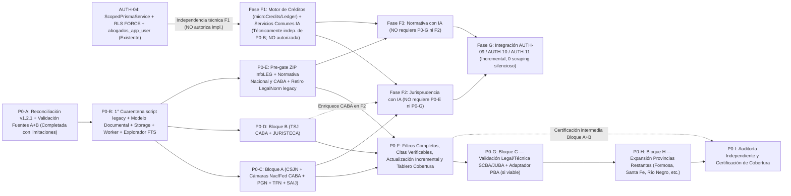

# LEGAL-AI-RESEARCH-IMPLEMENTATION-ROADMAP-001
## HOJA DE RUTA DE IMPLEMENTACIÓN — PROGRAMA P0 (COBERTURA NACIONAL) E INVESTIGACIÓN JURÍDICA CON IA

| Campo | Valor |
| :--- | :--- |
| **Expediente origen** | `LEGAL-AI-RESEARCH-ARCHITECTURE-SPEC-001` |
| **Expediente de reconciliación** | `LEGAL-P0-START-001` *(Fase P0-A)* |
| **Expediente de enmienda** | `LEGAL-P0-DOCUMENTARY-AMENDMENT-001` *(Micro-enmienda `v1.2.1`)* |
| **Versión** | `v1.2.1` |
| **Estado** | `DOCUMENTACIÓN ENMENDADA v1.2.1 — PENDIENTE DE APROBACIÓN FORMAL DEL PROPIETARIO` |
| **Aprobación del propietario** | `PENDIENTE` |
| **Fecha** | `2026-11-25` |
| **Autorización de implementación** | `NO AUTORIZADA — SOLO P0-A Y LA MICRO-ENMIENDA DOCUMENTAL v1.2.1 FUERON AUTORIZADAS; P0-B, F1 NI FASES POSTERIORES ESTÁN AUTORIZADAS` |
| **Documentos relacionados (`v1.2.1`)** | [LEGAL-AI-RESEARCH-ARCHITECTURE-SPEC-001.md](./LEGAL-AI-RESEARCH-ARCHITECTURE-SPEC-001.md) · [LEGAL-AI-JURISPRUDENCE-SPEC-001.md](./LEGAL-AI-JURISPRUDENCE-SPEC-001.md) · [LEGAL-AI-NORMATIVE-SPEC-001.md](./LEGAL-AI-NORMATIVE-SPEC-001.md) · [LEGAL-AI-CREDITS-SPEC-001.md](./LEGAL-AI-CREDITS-SPEC-001.md) *(`v1.2.0`, sin cambios)* · [LEGAL-KNOWLEDGE-LIBRARIES-ADR-001.md](./LEGAL-KNOWLEDGE-LIBRARIES-ADR-001.md) |
| **Registros P0-A (`v1.0.1`)** | [LEGAL-P0-SOURCE-VALIDATION-MATRIX-001.md](./LEGAL-P0-SOURCE-VALIDATION-MATRIX-001.md) · [LEGAL-P0-DECISIONS-DEPENDENCIES-MATRIX-001.md](./LEGAL-P0-DECISIONS-DEPENDENCIES-MATRIX-001.md) · [LEGAL-P0-A-EXECUTION-REPORT-001.md](./LEGAL-P0-A-EXECUTION-REPORT-001.md) |

### Historial de versiones
| Versión | Fecha | Expediente | Resumen de cambios |
| :--- | :--- | :--- | :--- |
| `v1.0.0` | `2026-11-25` | `LEGAL-AI-RESEARCH-ARCHITECTURE-SPEC-001` | Hoja de ruta inicial secuencial A→G con Fase F acoplada a C+D+E. |
| `v1.1.0` | `2026-11-25` | `LEGAL-AI-DOCUMENT-RECONCILIATION-001` | División de Fase F en `F1`/`F2`/`F3` desacopladas, contingencia SCBA/JUBA, benchmark LLM de 6 criterios y criterios TDS por fase. |
| `v1.2.0` | `2026-11-25` | `LEGAL-P0-START-001` *(P0-A)* | Integración completa del **Programa P0 (`P0-A` a `P0-I`)** priorizando **Bloque A (Nación/Federal CABA + PGN + TFN) + Bloque B (CABA autónoma: TSJ + JURISTECA + Normativa CABA)** antes que Bloque C (PBA/JUBA — `P0-G`) y Bloque H (resto de provincias — `P0-H`); reconciliación exacta de `DEC-ADR-01` (arquitectura cerrada vs. autorización ejecutiva `DEC-ADR-01-EXEC`) y `DEC-CRED-04` (`04A` desarrollo técnico F1 desbloqueado vs. `04B/C/D` habilitación comercial; créditos no bloquean P0); trazabilidad completa con las 23 categorías `TDS-P0-001..023`. |
| `v1.2.1` | `2026-11-25` | `LEGAL-P0-DOCUMENTARY-AMENDMENT-001` | Resolución de `P0-FBA-001`, `P0-FBA-004`, `P0-FBA-005`, `P0-FBA-006` y `P0-FBA-007`: traslado de la deshabilitación técnica y cuarentena fail-closed de `backend/scripts/ingest-legal-norms.ts` al primer paso técnico de `P0-B`; sincronización explícita de `DEC-P0-BUDGET-01` en §7; desacoplamiento técnico de `F1` respecto de `P0-B` (predecesor técnico AUTH-04, sin autorizar su implementación) y pre-gate de inspección técnica y jurídica del `ZIP` de InfoLEG previo a `P0-E`; definición explícita del Exit Gate TDS 100% offline de `P0-B`; alineación terminológica de `RESTRINGIDA_POR_ROBOTS_TXT`. |

---

## 1. Alineación entre Programa P0 (Base Jurídica) y Servicios Premium IA (`F1`, `F2`, `F3`, `G`)

El roadmap unifica la reparación estructural de la base jurídica gratuita (**Programa P0: `P0-A` a `P0-I`**) con la posterior capa de servicios premium de IA (**Fases `F1`, `F2`, `F3` y `G`**):

1. **Prioridad jurisdiccional reconciliada:**
   - **Primer bloque:** **Bloque A** (`AR-NACION` + `AR-FEDERAL` con asiento en CABA + PGN + TFN → `P0-C`) y **Bloque B** (`AR-CABA`: TSJ CABA + JURISTECA → `P0-D`), acompañados por **Normativa Nacional (InfoLEG) + Normativa CABA (BOCABA API + Digesto/CEDOM)** (`P0-E`).
   - **Expansión posterior:** **Bloque C** (`AR-PBA`: SCBA/JUBA → `P0-G`) y **Bloque H** (resto de las jurisdicciones provinciales, incluyendo Formosa, Santa Fe, Río Negro, etc. → `P0-H`).
2. **No bloqueo de `P0-B` por fuentes externas:** la reparación del Explorador (FTS español + GIN, 0 `Math.random()`, 0 XSS, 0 fallback silencioso) y del modelo documental (`P0-B`) **no se bloquea** por ninguna fuente externa ni por restricciones de `robots.txt` o licencias de portales específicos.
3. **Desacoplamiento estricto de créditos (`DEC-CRED-04`):**
   - Las decisiones comerciales de créditos (`DEC-CRED-03`, `DEC-CRED-04B/C/D`) **NO bloquean ninguna fase del Programa P0 (`P0-A..P0-I`)** ni el desarrollo/pruebas técnicas de `F1` con fixtures y cuotas no comerciales explícitas (`DEC-CRED-04A`).
   - La **habilitación comercial en producción** de `F1`/`F2`/`F3` sí requiere aprobación expresa de `DEC-CRED-04B` (y `DEC-CRED-03` para Búsqueda amplia).
4. **Desacoplamiento entre servicios premium:**
   - **Fase F2 (Jurisprudencia con IA)** depende de `F1 + P0-C` (y opcionalmente `P0-D`/`P0-F`); **no requiere** que Normativa (`P0-E`), PBA (`P0-G`) ni todas las provincias (`P0-H`) estén terminadas.
   - **Fase F3 (Normativa con IA)** depende de `F1 + P0-E`; **no requiere** que PBA (`P0-G`) ni Jurisprudencia con IA (`F2`) estén implementadas.

---

## 2. Diagrama de dependencias (`P0-A..P0-I` y `F1/F2/F3/G`)

---

## 3. Matriz formal de dependencias

| Fase | Depende obligatoriamente de | NO depende de (Desacoplamiento explícito) | Habilita | Prerrequisitos / autorizaciones externas |
| :--- | :--- | :--- | :--- | :--- |
| **P0-A** *(Ejecutada)* | Ninguna fase previa | Implementación, DB, créditos | `P0-B` | Aprobación del baseline `v1.2.1` por el propietario |
| **P0-B** *(equivale a ex-Fases A+B)* | `P0-A` | Fuentes externas concretas, Internet, `pgvector`, OpenAI, créditos | `P0-C`, `P0-D`, `P0-E` | **`DEC-IMPL-P0B`** + autorización ejecutiva **`DEC-ADR-01-EXEC`** (creación del rol) + **`DEC-ADR-02/03`** *(+ `DEC-P0-BUDGET-01` solo si se elige S3 pago; **primer paso técnico:** cuarentena fail-closed `ingest-legal-norms.ts`)* |
| **P0-C** *(Bloque A)* | `P0-B` | `P0-D` (CABA), `P0-E` (Normativa), `P0-G` (PBA), créditos | `P0-F`, `F2` | Evaluación jurídica en 7 planos **`DEC-P0-LEGAL-01`** para fuentes `RESTRINGIDA_POR_ROBOTS_TXT` o `VIABLE_CON_CONDICIONES` |
| **P0-D** *(Bloque B)* | `P0-B` | `P0-C`, `P0-E`, `P0-G`, créditos | `P0-F`, cobertura CABA en `F2` | Evaluación jurídica en 7 planos **`DEC-P0-LEGAL-01`** (especialmente JURISTECA `RESTRINGIDA_POR_ROBOTS_TXT` y TSJ CABA) |
| **P0-E** *(Normativa A+B)* | `P0-B` | `P0-C`, `P0-D`, `P0-G`, créditos | `P0-F`, `F3`, Explorador Normativo | **`DEC-NORM-01/02/03`** + **Pre-gate obligatorio de inspección técnica y jurídica del paquete `ZIP` oficial de InfoLEG (`datos.jus.gob.ar`)** (estructura, contenido textual, integridad, metadatos, frecuencia de actualización y condiciones de reutilización) + verificación comercial BOCABA/Digesto |
| **P0-F** | `P0-C`, `P0-D`, `P0-E` *(o incremental por bloque listo)* | `P0-G` (PBA), `P0-H`, créditos | `P0-G`, `P0-I` (certif. A+B) | Criterios de citas y actualización incremental verificados |
| **P0-G** *(Bloque C — PBA/JUBA)* | `P0-F` *(o `P0-B` + Core)* | `P0-E`, `F1`, `F3` | Cobertura PBA en Biblioteca y `F2` | Validación legal/técnica `P0-G.1` *(si no es viable, documentar sin evadir; NO bloquea F1/F2/F3)* |
| **P0-H** *(Bloque H — Otras provincias)* | `P0-F` (y patrón `P0-G`) | Créditos | Cobertura nacional ampliada | **`DEC-JUR-02`** (orden de oleadas provinciales) + validación legal por provincia |
| **P0-I** | `P0-F` (certif. A+B) / `P0-H` (nacional) | Créditos | Certificación auditable de cobertura | Auditoría independiente de muestras contra fuentes oficiales |
| **Fase F1** *(Técnico vs. Comercial)* | **AUTH-04** *(`ScopedPrismaService`, RLS habilitado y forzado donde corresponda, aislamiento por organización, permisos de lectura adecuados y verificación con rol runtime `abogados_app_user`)* | **`P0-B`**, `P0-C`, `P0-D`, `P0-E`, `P0-G` *(desacoplada técnicamente de `P0-B`)* | `F2`, `F3` | Desarrollo técnico desbloqueado con fixtures (`DEC-CRED-04A`) + autorización expresa independiente *(**esta independencia técnica NO autoriza implementar `F1`**)*; **habilitación comercial requiere `DEC-CRED-04B/C`** |
| **Fase F2** *(Jurisprudencia con IA)* | `F1` + `P0-C` *(y opcional `P0-D`/`P0-F`)* | **NO depende de `P0-E` (Normativa) ni `P0-G` (JUBA) ni `P0-H`** | Fase G (jurisprudencia) | Benchmark obligatorio de 6 criterios (**`DEC-ARCH-02`**) + **`DEC-CRED-03`** (solo para Búsqueda amplia) + **`DEC-JUR-03`** |
| **Fase F3** *(Normativa con IA)* | `F1` + `P0-E` | **NO depende de `P0-G` (JUBA) ni `F2`** | Fase G (normativa) | Benchmark obligatorio de 6 criterios (**`DEC-ARCH-02`**) |
| **Fase G** | `F2` y/o `F3` *(incremental)* | No requiere esperar `F3` para integrar `F2` ni viceversa | Reutilización segura en AUTH-09/10/11 | Estabilidad productiva de la(s) biblioteca(s) y servicio(s) |

---

## 4. Gate obligatorio de Benchmark LLM (Previo a F2 y F3 — `DEC-ARCH-02`)

Antes de fijar cualquier modelo definitivo de IA para **F2** o **F3**, se ejecutará un **benchmark jurídico y técnico documentado** sobre `LEGAL_AI_PROVIDER` (con configuración multi-modelo por tarea) evaluando obligatoriamente **6 criterios**:
1. Calidad de razonamiento jurídico en derecho argentino.
2. Fidelidad literal de citas (0 citas inventadas, 3 niveles de verificación).
3. Calidad de síntesis estructurada (separación literal vs. explicación).
4. Detección de criterios divergentes y contradicciones.
5. Latencia extremo a extremo.
6. Costo interno real por investigación (contraste contra referencia `0,4` créditos y calibración de `DEC-CRED-03`).

> **Principio rector:** *la calidad jurídica tiene prioridad sobre minimizar el costo a cualquier precio.*

---

## 5. Detalle de fases P0 y F1/F2/F3/G

- **P0-A (Ejecutada — solo documental y validación):** reconciliación `v1.2.0` (y micro-enmienda `v1.2.1`) de los documentos Legal AI, validación técnica/jurídica de fuentes de Bloques A y B (incluyendo CSJN Tomos Fallos), matriz consolidada de fuentes y matriz de dependencias/decisiones. **0 código productivo.**
- **P0-B (Cuarentena fail-closed del script legacy + Reparación del modelo documental y del Explorador):**
  - **Primer paso técnico obligatorio (`P0-FBA-004`):** deshabilitación técnica y cuarentena fail-closed de `backend/scripts/ingest-legal-norms.ts` garantizando que: (1) el script no pueda ejecutarse accidentalmente, (2) no se cargue ninguno de los 5 registros incorrectos, (3) no se corrijan para incorporarlos al corpus, (4) no se reutilicen como fixtures jurídicos válidos, (5) quede documentada la evidencia de su cuarentena y (6) el retiro definitivo del modelo `LegalNorm`, sus migraciones o su esquema continúe en `P0-E`.
  - **Núcleo técnico de `P0-B`:** esquema documental común (`Jurisprudence*`, `JurisprudenceVersion`, catálogos canónicos de organismos/tribunales/salas/fueros, `CatalogIngestionRun/Audit`), storage privado inmutable con `SHA-256`, creación controlada de `abogados_catalog_ingestor` (solo tras `DEC-ADR-01-EXEC`), reparación total del Explorador (`tsvector` español + `unaccent` + GIN, eliminación de `Math.random()`, eliminación de cast roto, eliminación de fallback silencioso a `listAll()`, corrección de `rankingScore` y XSS en frontend).
- **P0-C (Ingesta Bloque A — Nación/Federal con asiento en CABA):** adaptadores validados para CSJN (con métricas separadas para Colección Fallos Tomos PDF, Sumarios, Sentencias completas, Sentencias recientes y Acordadas), Cámaras Nacionales y Federales en CABA (respetando estrictamente la restricción técnica `RESTRINGIDA_POR_ROBOTS_TXT` detectada en `csjn.gov.ar/robots.txt`, operando solo mediante canal autorizado/convenio o fuentes abiertas válidas), SAIJ (`datos.jus.gob.ar` CC-BY-4.0), PGN (`mpf.gob.ar`, clasificado como dictamen) y TFN (`jurisprudenciatfn.mecon.gob.ar`, clasificado como tribunal administrativo-jurisdiccional).
- **P0-D (Ingesta Bloque B — Jurisdicción autónoma CABA):** adaptadores para TSJ CABA y JURISTECA (respetando `RESTRINGIDA_POR_ROBOTS_TXT` en `juristeca.jusbaires.gob.ar/robots.txt`, condicionado a canal de datos abiertos del Consejo de la Magistratura CABA o autorización institucional), con código territorial estricto `AR-CABA` sin mezclar con Justicia Nacional.
- **P0-E (Pre-gate ZIP InfoLEG + Biblioteca normativa Nacional y CABA + Retiro `LegalNorm` legacy):** inicia obligatoriamente con el **pre-gate de inspección técnica y jurídica del paquete `ZIP` oficial de InfoLEG (`datos.jus.gob.ar`)** verificando estructura, contenido textual, integridad, metadatos, frecuencia de actualización y condiciones de reutilización; luego ejecuta retiro definitivo del modelo legacy `LegalNorm`/migraciones/esquema, modelo normalizado (`NormativeDocument`, `NormativeTextVersion` con variantes `ORIGINAL | UPDATED | CONSOLIDATED`, `NormativeArticle`, `NormativeArticleVersion`, `NormativeRelation`, `JurisprudenceNormCitation`), 9 hitos temporales, 4 planos de vigencia (`UNKNOWN_UNVERIFIED` por defecto), ingesta `AR-NACION` vía InfoLEG (`datos.jus.gob.ar` CC-BY-4.0) y `AR-CABA` vía BOCABA API REST + Digesto/CEDOM, y Explorador Normativo FTS gratuito.
- **P0-F (Búsqueda avanzada, citas verificables, actualización incremental y Tablero de Cobertura):** 12 filtros estructurados combinados, `VerifiedLegalCitation` con anclas de página/considerando, jobs incrementales con detección de fuentes caídas y Tablero de Cobertura administrativo (sin denominadores inventados).
- **P0-G (Bloque C — SCBA/JUBA y PBA):** Subfase `P0-G.1` (validación legal y técnica viva ante restricción comercial expresa de SCBA); `P0-G.2` solo si es legal y técnicamente viable; si no lo es, documentar formalmente sin evadir controles.
- **P0-H (Bloque H — Demás jurisdicciones provinciales):** expansión por oleadas (Formosa, Santa Fe, Río Negro, Córdoba, Mendoza, etc.) sobre el mismo Core Jurídico Nacional.
- **P0-I (Auditoría independiente y certificación de cobertura):** verificación de muestras aleatorias contra fuentes oficiales, auditoría de integridad SHA-256 y seguridad RLS, y certificación de cierre al 100% por bloque.
- **F1 / F2 / F3 / G:** motor de créditos (`microCredits`, ledger inmutable, idempotencia, recuperación ante caídas — **técnicamente independiente de `P0-B`**, dependiente de AUTH-04, sin que esto autorice su implementación), Jurisprudencia con IA (desacoplada de Normativa/PBA), Normativa con IA (desacoplada de PBA/F2) e integración transversal en solo lectura sin scraping silencioso en AUTH-09/10/11.

---

## 6. Política TDS obligatoria y contrato de pruebas (`TDS-P0-001` a `TDS-P0-023` + `F1..G`)

> [!NOTE]
> **Alcance documental (`P0-A`):** En `P0-A` **NO se crean ni modifican tests productivos**. Toda fase futura inicia obligatoriamente con tests en **RED**, continúa con implementación en **GREEN** y cierra con regresión completa AUTH-01..AUTH-11 y evidencia.

### 6.1. Trazabilidad del contrato TDS del Programa P0 (`TDS-P0-001..023`) y Exit Gate offline de `P0-B` (`P0-FBA-007`)

#### Exit Gate TDS de `P0-B` (100% offline con fixtures locales y mocks)
El **Exit Gate TDS de `P0-B`** debe poder ejecutarse íntegramente **offline**, utilizando únicamente **fixtures locales y mocks**, sin acceso a Internet, sin scraping a fuentes oficiales y sin datos jurídicos reales descargados en vivo (preservando la política **RED → GREEN**):
- **`TDS-P0-001` a `TDS-P0-006`** (integridad SHA-256, deduplicación sobre fixtures simulados, idempotencia, versionado histórico, `FULL_SENTENCE` vs. `OFFICIAL_SUMMARY` con `textoCompleto = NULL`, clasificación `JurisprudenceContentKind` / `sourceAuthorityKind` y métricas separadas CSJN).
- **`TDS-P0-008` excluyendo el filtro `normaCitada`** (los demás filtros estructurados combinados sobre fixtures locales).
- **`TDS-P0-009`, `TDS-P0-010`, `TDS-P0-011`** (búsqueda exacta, FTS español + `unaccent` + GIN sin `pgvector`/OpenAI ni `Math.random()` ni fallback `listAll()`, paginación real determinista).
- **`TDS-P0-015` con mocks de controles anti-SSRF, MIME y tamaño** (sin tráfico de red hacia Internet).
- **`TDS-P0-016`, `TDS-P0-017`, `TDS-P0-018`, `TDS-P0-019`** (rechazo y cuarentena de fixtures inválidos, aislamiento multi-tenant, RLS `ENABLE + FORCE`, privilegios `abogados_app_user` vs. `abogados_catalog_ingestor`).
- **Verificación offline de cuarentena técnica fail-closed de `backend/scripts/ingest-legal-norms.ts`** *(primer paso técnico de `P0-B`)*.

**Pruebas diferidas explícitamente a `P0-C`, `P0-D`, `P0-E` y `P0-F`:** pruebas inter-fuente reales contra adaptadores oficiales, filtro `normaCitada` completo en `TDS-P0-008`, fixtures oficiales descargados y validación real de adaptadores/fuentes (`TDS-P0-007`, `TDS-P0-012`, `TDS-P0-013`, `TDS-P0-014`, `TDS-P0-020..023`).

#### Mapa completo por categoría (`TDS-P0-001..023`)
- **Integridad, duplicados y versiones (`P0-B` offline / `P0-C` real):** `TDS-P0-001` (SHA-256 y detección `HASH_MISMATCH`), `TDS-P0-002` (deduplicación sobre fixtures en `P0-B`; inter-fuente real en `P0-C`), `TDS-P0-003` (reingesta idempotente), `TDS-P0-004` (versionado histórico inmutable), `TDS-P0-005` (íntegros vs. parciales: `textoCompleto = NULL` en sumarios), `TDS-P0-006` (clasificación `JurisprudenceContentKind` y `sourceAuthorityKind`), `TDS-P0-016` (rechazo y cuarentena de documentos inválidos).
- **Búsqueda y filtros (`P0-B` offline / `P0-F` completo):** `TDS-P0-008` (filtros estructurados combinados en `P0-B` excluyendo `normaCitada`; los 12 completos en `P0-F`), `TDS-P0-009` (búsqueda exacta expediente y frases), `TDS-P0-010` (FTS español + `unaccent` sin `pgvector` ni `Math.random()` ni fallback `listAll()`), `TDS-P0-011` (paginación real determinista).
- **Jurisdicción, resiliencia y respeto de fuentes (`P0-C` / `P0-D`; mocks anti-SSRF en `P0-B`):** `TDS-P0-007` (separación `AR-NACION` / `AR-FEDERAL` / `AR-CABA` / `AR-PBA`), `TDS-P0-013` (fuentes caídas / degradación aislada), `TDS-P0-014` (reintentos, backoff, circuit-breaker y detención limpia ante CAPTCHA/403/`robots.txt` sin evasión, distinguiendo `RESTRINGIDA_POR_ROBOTS_TXT` de `BLOQUEADA_POR_RESTRICCION_LEGAL`), `TDS-P0-015` (rate-limits, MIME, tope de bytes y anti-SSRF con mocks en `P0-B` y validación real en `P0-C`/`P0-E`).
- **Seguridad y aislamiento (`P0-B` / `P0-F`):** `TDS-P0-017` (aislamiento multi-tenant de notas/favoritos/investigaciones), `TDS-P0-018` (RLS `ENABLE + FORCE` en PostgreSQL), `TDS-P0-019` (`abogados_app_user` `SELECT`-only sobre Cat. C; `abogados_catalog_ingestor` sin `SUPERUSER`/`BYPASSRLS`/`CREATEROLE`/`CREATEDB`/DDL/acceso multi-tenant).
- **Normativa (`P0-B` cuarentena script / `P0-E` corpus y retiro legacy):** `TDS-P0-020` (cuarentena fail-closed de `ingest-legal-norms.ts` como primer paso de `P0-B`; actualización normativa, corrección `versionNorma` y retiro de `LegalNorm` legacy en `P0-E`), `TDS-P0-021` (9 hitos temporales y `UNKNOWN_UNVERIFIED` por defecto), `TDS-P0-022` (relaciones modificatorias/derogatorias y `JurisprudenceNormCitation`).
- **Citas y anti-alucinación (`P0-F` / `F2` / `F3`):** `TDS-P0-012` (`VerifiedLegalCitation` con ancla documental y URL oficial), `TDS-P0-023` (rechazo mecánico de citas falsas o sumarios presentados como sentencias completas + advertencia literal obligatoria).
- **Ampliaciones identificadas en `P0-A` / `v1.2.1` (sin alterar IDs originales):** ampliar `TDS-P0-006` para validar la separación de métricas CSJN (Colección Fallos Tomos PDF vs. Sumarios vs. Sentencias individuales vs. Acordadas), ampliar `TDS-P0-014` para validar verificación obligatoria de `robots.txt` distinguiendo `RESTRINGIDA_POR_ROBOTS_TXT` de `BLOQUEADA_POR_RESTRICCION_LEGAL`, y verificar en el primer paso técnico de `P0-B` la cuarentena fail-closed de `ingest-legal-norms.ts` (y en `P0-E` el retiro de `LegalNorm` legacy y cuarentena de normas sin procedencia oficial en `TDS-P0-020`).

### 6.2. Pruebas TDS para Fases `F1`, `F2`, `F3` y `G`
- **Fase F1:** precisión `microCredits`, concurrencia `SELECT ... FOR UPDATE`, idempotencia `(organizationId, idempotencyKey)`, tarifa congelada `appliedRateMicroCredits`, ledger append-only inmutable, recuperación simulada ante caída entre persistencia y commit, RLS `FORCE` (ejecutables con fixtures no comerciales `DEC-CRED-04A`).
- **Fase F2:** Plan de Investigación con `0` créditos y `0` scraping previo, 1 búsqueda lógica multi-fuente = 1 cargo, vacíos/fallos = `0`, parciales útiles = 1 cargo listando faltantes, `JURISPRUDENCE_AI_WIDE_RESEARCH`, 3 niveles de verificación, taxonomía PGN/PTN/TFN, advertencia literal aprobada, operación independiente sin `P0-E` ni `P0-G`.
- **Fase F3:** separación estricta texto literal vs. explicación IA, 4 planos de vigencia, 0 artículos inventados, facturación 1 operación lógica, operación independiente sin `P0-G` ni `F2`.
- **Fase G:** consulta solo lectura en AUTH-09/10/11 con `0` scraping silencioso, confirmación explícita con aviso de créditos para nuevas investigaciones y regresión verde AUTH-01..AUTH-11.

---

## 7. Resumen de autorizaciones ejecutivas y decisiones pendientes

*(Detalle completo y trazabilidad de bloqueo en [LEGAL-P0-DECISIONS-DEPENDENCIES-MATRIX-001.md](./LEGAL-P0-DECISIONS-DEPENDENCIES-MATRIX-001.md).)*

| ID | Tipo | Resumen | Impacto |
| :--- | :--- | :--- | :--- |
| **DEC-IMPL-P0B** | Autorización ejecutiva | Aprobación del baseline `v1.2.1` y autorización expresa posterior para iniciar `P0-B`. | `P0-B` |
| **DEC-ADR-01-EXEC** | Autorización ejecutiva | Autorización expresa para crear el rol `abogados_catalog_ingestor` en PostgreSQL *(diseño arquitectónico cerrado)*. | `P0-B` |
| **DEC-ADR-02 / 03** | Decisión técnica | Storage local privado sin costo adicional (`KNOWLEDGE_STORAGE_ROOT`) vs. S3 y política de retención/TTL. | `P0-B` |
| **DEC-P0-LEGAL-01** | Decisión jurídica | Evaluación en 7 planos (condiciones de uso, licencia, Ley 11.723, Ley 25.326, restricciones contractuales y eventuales convenios institucionales) para fuentes `RESTRINGIDA_POR_ROBOTS_TXT` o `VIABLE_CON_CONDICIONES`. | `P0-C`, `P0-D`, `P0-G` |
| **DEC-NORM-01 / 02 / 03** | Decisión funcional | Corpus inicial Nacional + CABA, cadencia de sincronización y retiro definitivo de `LegalNorm` legacy en `P0-E` *(cuarentena de `ingest-legal-norms.ts` ya ejecutada al inicio de `P0-B`)*. | `P0-E` |
| **DEC-ARCH-02** | Decisión técnica | Benchmark LLM de 6 criterios y modelo(s) por tarea. | `F2`, `F3` |
| **DEC-CRED-03** | Decisión comercial | Precio numérico de `JURISPRUDENCE_AI_WIDE_RESEARCH` tras medir costos. | `F2` (Búsqueda amplia) |
| **DEC-CRED-04B / C / D** | Decisión comercial | Dotación comercial por plan (`04B`), packs (`04C`) y migración futura AUTH-09/10/11 (`04D`). *(NO bloquean P0 ni F1 técnico.)* | Habilitación comercial `F1`/`F2`/`F3` |
| **DEC-JUR-02 / 03** | Decisión funcional | Orden de provincias Bloque H y tope de precedentes por síntesis. | `P0-H`, `F2` |
| **DEC-P0-BUDGET-01** | Autorización de gasto | Aprobación presupuestaria expresa para **cualquier gasto en servicios externos pagos o infraestructura paga** (S3 cloud, OCR pago, APIs pagas, benchmark LLM o infraestructura adicional). **NO convierte en obligación de gasto una opción de almacenamiento local sin costo adicional (`KNOWLEDGE_STORAGE_ROOT`).** | Cualquier fase que incurra en gasto pago *(NO bloquea `P0-B` con almacenamiento local)* |
