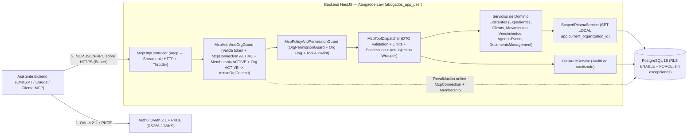

# LEGAL-EXTERNAL-ASSISTANTS-MCP-ADR-001
## DECISIONES ARQUITECTÓNICAS (ADR) — CONECTOR MCP, INTEGRACIÓN CON AUTH-01..11 Y HALLAZGOS DE AUDITORÍA

| Campo | Valor |
| :--- | :--- |
| **Expediente** | `LEGAL-EXTERNAL-ASSISTANTS-SPEC-001` |
| **Versión** | `v1.0.0` |
| **Estado** | `BORRADOR — PENDIENTE DE APROBACIÓN FORMAL DEL PROPIETARIO` |
| **Fecha** | `2026-11-25` |
| **Autorización de implementación** | `NO AUTORIZADA` |
| **Documentos del paquete** | [LEGAL-EXTERNAL-ASSISTANTS-SPEC-001.md](./LEGAL-EXTERNAL-ASSISTANTS-SPEC-001.md) · [LEGAL-EXTERNAL-ASSISTANTS-SECURITY-001.md](./LEGAL-EXTERNAL-ASSISTANTS-SECURITY-001.md) · [LEGAL-EXTERNAL-ASSISTANTS-PROMPT-CATALOG-001.md](./LEGAL-EXTERNAL-ASSISTANTS-PROMPT-CATALOG-001.md) · [LEGAL-EXTERNAL-ASSISTANTS-ROADMAP-001.md](./LEGAL-EXTERNAL-ASSISTANTS-ROADMAP-001.md) |

### Historial de versiones
| Versión | Fecha | Expediente | Resumen de cambios |
| :--- | :--- | :--- | :--- |
| `v1.0.0` | `2026-11-25` | `LEGAL-EXTERNAL-ASSISTANTS-SPEC-001` | ADR inicial de arquitectura del conector MCP, reutilización estricta de servicios/RLS/Auth0 y registro de hallazgos de auditoría READ-ONLY. |

---

## 1. Contexto arquitectónico

Abogados-Law ya dispone de una arquitectura de seguridad y dominio consolidada en **AUTH-01 a AUTH-11**:
- Sesiones web BFF (`app_session` + `csrf_token`) y validación RS256 contra Auth0 JWKS (`Auth0JwtGuard` + `JwksKeystoreService`).
- Contexto organizacional congelado (`ActiveOrgContextGuard`), matriz RBAC fail-closed (`OrgPermissionGuard`, `backend/src/authz/permissions.ts`) y proyecciones mínimas de columnas por rol.
- Aislamiento transaccional de tenant vía `ScopedPrismaService` (`SET LOCAL app.current_organization_id`) y PostgreSQL RLS `ENABLE + FORCE` sobre 31 tablas con `abogados_app_user`.
- Servicios de dominio maduros (`ClientsService`, `ExpedientesService`, `MovimientosService`, `VencimientosService`, `AgendaEventsService`, `DocumentsManagementService`) y utilidades defensivas de IA (`DocumentTextExtractorService`, delimitadores `<UNTRUSTED_*>`).

El conector MCP debe integrarse como un **adaptador de borde (inbound adapter)** sobre esa arquitectura, **sin crear un sistema paralelo de autenticación, RBAC, organizaciones ni acceso directo a datos**.

---

## 2. Decisiones arquitectónicas propuestas

### ADR-EA-01 — Adaptador MCP exclusivamente sobre servicios de dominio (Cero acceso directo a Prisma/PostgreSQL)
- **Decisión:** El futuro módulo `ExternalAssistantsMcpModule` **NO puede inyectar `PrismaService` para consultar tablas de negocio** (`Expediente`, `Client`, `Document`, `MovimientoProcesal`, `Vencimiento`, `AgendaEvent`) ni ejecutar SQL crudo. Cada herramienta MCP actúa como un adaptador delgado que:
  1. Valida argumentos de entrada con DTOs estrictos (`whitelist: true`, `forbidNonWhitelisted: true`).
  2. Construye o recibe el `ActiveOrgContext` congelado (`Object.freeze`) resuelto por el servidor.
  3. Invoca los servicios de dominio existentes (`ExpedientesService`, `ClientsService`, `MovimientosService`, `VencimientosService`, `AgendaEventsService`, `DocumentsManagementService`, `DocumentTextExtractorService`).
  4. Aplica un serializador de minimización de datos (enmascaramiento PII, truncado, `FORBIDDEN_RESPONSE_FIELDS`, envoltorios `<UNTRUSTED_*>`).
- **Alternativa descartada:** Consultar tablas Prisma directamente desde handlers MCP. *Rechazada* porque duplicaría reglas de negocio, proyecciones de columnas y controles de AUTH-05..08, elevando el riesgo de fuga de datos.

### ADR-EA-02 — Identidad y autenticación MCP mediante OAuth 2.1 + PKCE sobre Auth0 y `McpConnection` server-side
- **Decisión:**
  - Los clientes MCP remotos modernos (ChatGPT Connectors, Claude Remote MCP) soportan el estándar **MCP Authorization (OAuth 2.1 + PKCE + Protected Resource Metadata `/.well-known/oauth-protected-resource`)**.
  - Reutilizar **Auth0** (ya integrado en `Auth0JwtGuard` / `Auth0JwtStrategy` / `JwksKeystoreService`) como Authorization Server para autenticar individualmente al usuario, añadiendo un paso de **vinculación organizacional y consentimiento** dentro de Abogados-Law autenticado por sesión BFF que crea un registro `McpConnection` en PostgreSQL.
  - Cada `McpConnection` fija en servidor de manera inmutable: `(userId, organizationId, clientName, grantedScopes, consentVersion, acceptedPrivacyAt, status = ACTIVE, expiresAt, revokedAt)`.
  - En cada llamada MCP, `McpAuthAndOrgGuard` valida: (a) firma RS256/JWKS del token, (b) existencia y estado `ACTIVE` no expirado ni revocado de `McpConnection` (vinculado por `jti`/token-binding o `connectionId`), (c) `OrganizationMembership.status === ACTIVE` en vivo para `(userId, connection.organizationId)` usando `membership.role` como única fuente de RBAC, y (d) `Organization.status === ACTIVE` con `mcpEnabled = true`.
  - **Alternativa evaluada para clientes sin OAuth 2.1 dinámico (`DEC-EA-ARC-01`):** emisión controlada desde sesión BFF de tokens opacos por conexión (CSPRNG 256 bits, almacenados únicamente como hash `SHA-256` en `McpConnection`, con rotación, TTL acotado y revocación inmediata), únicamente si un cliente objetivo no soporta OAuth 2.1 remoto. **Nunca** se usarán cookies BFF (`app_session`), secretos compartidos de organización ni API keys sin identidad individual.
- **Prohibición expresa:** **NUNCA** reutilizar `SecurityContextGuard` legacy ni leer `User.organizationId` / `User.role` para resolver el tenant de una llamada MCP (ver `FINDING-SEC-01`).

### ADR-EA-03 — Transporte MCP remoto mediante Streamable HTTP sobre HTTPS dedicado
- **Decisión:**
  - Exponer el servidor MCP en un prefijo aislado (ej. `POST/GET/DELETE /mcp`) utilizando el transporte estándar **Streamable HTTP** sobre **HTTPS (TLS 1.2/1.3 obligatorio)** con `Content-Type: application/json` / SSE controlado, desacoplado de las cookies BFF de la SPA.
  - Rechazar solicitudes con `Origin` malicioso/inesperado cuando el cliente envíe cabeceras de navegador (prevención DNS rebinding / CSRF), desactivar cualquier exposición sin TLS en producción y aplicar `@nestjs/throttler` con perfiles dedicados por `(organizationId, userId, connectionId, toolName)`.
  - No requiere ni habilita transporte `stdio` local en servidores multi-tenant de producción.

### ADR-EA-04 — Preservación estricta de AUTH-04 y RLS `ENABLE + FORCE` en nuevas tablas MCP
- **Decisión:**
  - **Cero excepciones a RLS.** Todas las nuevas tablas del módulo MCP (`McpConnection`, `McpPrivacyConsent`, y en Fase C `McpWriteConfirmationTicket`) llevarán obligatoriamente `organizationId NOT NULL`, índice compuesto por `organizationId` y políticas PostgreSQL **RLS `ENABLE + FORCE`** idénticas a AUTH-04, operadas bajo `abogados_app_user` vía `ScopedPrismaService`.
  - Para la resolución inicial de la conexión a partir del identificador opaco/token entrante antes de conocer `organizationId`, se empleará una función/política controlada fail-closed estrictamente equivalente al patrón ya aprobado en AUTH-04 para `UserSession`, sin otorgar `BYPASSRLS` a `abogados_app_user`.
  - Toda ejecución de herramienta de negocio ocurre dentro de `ScopedPrismaService.runInOrgContext(activeOrgContext, ...)` asegurando `SET LOCAL app.current_organization_id` con limpieza automática en `COMMIT`/`ROLLBACK`.

### ADR-EA-05 — Defensa de borde contra Prompt Injection y minimización de payloads
- **Decisión:**
  - Toda respuesta de herramienta MCP que incluya texto libre proveniente de expedientes, movimientos o extractos documentales debe:
    1. Reutilizar `DocumentTextExtractorService` (tope 5 MB, anti-ZIP-bomb 2 MB, verificación SHA-256 vía AUTH-08).
    2. Filtrar sistemáticamente toda clave listada en `FORBIDDEN_RESPONSE_FIELDS` (`passwordHash`, `sessionToken`, `storageKey`, `storagePath`, `encryptedPassword`, etc.).
    3. Encapsular contenido textual libre con delimitadores explícitos (`<UNTRUSTED_STUDY_DATA sourceType="..." sourceId="...">`) y metadato estructural `dataTrustLevel: "UNTRUSTED_DATA_NOT_INSTRUCTIONS"`, replicando el patrón verificado en `LegalAiContextService` (AUTH-10).
    4. Aplicar topes duros de bytes/caracteres por herramienta (16–32 KB por respuesta) y límites de página en servidor.

### ADR-EA-06 — Protocolo de confirmación humana e idempotencia para futuras escrituras (Fase C/D)
- **Decisión:**
  - Las futuras herramientas de escritura (`crear_evento`, `crear_vencimiento`, `registrar_movimiento`, y eventualmente `crear_tarea`/`agregar_nota`) operarán bajo un patrón de **dos fases (Two-Phase Confirmation / Action Ticket)** para acciones sensibles:
    1. La herramienta MCP valida permisos, payload e `idempotencyKey` (`UNIQUE(organizationId, idempotencyKey)`) y crea un **borrador pendiente de confirmación (`McpPendingAction`)** con TTL breve (ej. 15 minutos), devolviendo un resumen estructurado y un enlace profundo a Abogados-Law (autenticado con sesión BFF) donde el abogado revisa y confirma explícitamente.
    2. Solo tras la confirmación humana en Abogados-Law (o confirmación explícita firmada si el cliente MCP soporta elicitación verificada en servidor y la política de la acción lo admite), se ejecuta el servicio de dominio correspondiente registrando `origen = "MCP_ASSISTANT"` y doble asiento en `AuditLog`.
  - Garantiza que un prompt injection en un documento jamás pueda disparar escrituras silenciosas sin consentimiento del abogado.

### ADR-EA-07 — Independencia total de la Biblioteca de Prompts respecto de MCP
- **Decisión:**
  - La Biblioteca de Prompts (Fase A) se modela como un catálogo versionado de solo lectura (JSON/TS estructurado en el repositorio o tabla global Categoría C `SELECT`-only), servido sin requerir conexión MCP, sin consumir `LEGAL_AI_PROVIDER` ni créditos y sin depender de la infraestructura de Fase B.

---

## 3. Hallazgos de auditoría READ-ONLY sobre código existente *(Documentados — NO corregidos en esta fase)*

En cumplimiento estricto de §2.1, se registran los hallazgos detectados sin modificar ningún módulo cerrado:

| ID Hallazgo | Ubicación verificada | Descripción técnica | Impacto en Asistentes Externos |
| :--- | :--- | :--- | :--- |
| **FINDING-SEC-01** | [security-context.guard.ts](file:///c:/Users/ruben/Documents/Mis-Proyectos/Abogados_law/backend/src/auth/guards/security-context.guard.ts#L74-L109) | `SecurityContextGuard` conserva un fallback transitorio que busca `User` por `sub` si no existe `UserIdentity`, y construye `activeOrgId` y `role` desde las columnas legacy `user.organizationId` y `user.role` sin revalidar `OrganizationMembership` (`ACTIVE`) ni `Organization` (`ACTIVE`). | **CRÍTICO si se reutilizara por error en MCP.** El futuro `McpAuthAndOrgGuard` NO debe usar `SecurityContextGuard`; debe revalidar en vivo `McpConnection`, `OrganizationMembership` y `Organization` igual que `ActiveOrgContextGuard`. |
| **FINDING-MOD-01** | [schema.prisma](file:///c:/Users/ruben/Documents/Mis-Proyectos/Abogados_law/backend/prisma/schema.prisma) y `backend/src/` | No existen modelos, tablas, servicios ni permisos para **Tareas**, **Honorarios**, **Cobranza/Facturación**, **Alertas dedicadas** ni **Notas dedicadas**. | Impide implementar `listar_tareas`, `crear_tarea`, `consultar_honorarios` y `consultar_estado_cobranza` en Fase B; obliga a ajustar el roadmap y marcar prompts dependientes como pendientes. |
| **FINDING-DOC-01** | [schema.prisma](file:///c:/Users/ruben/Documents/Mis-Proyectos/Abogados_law/backend/prisma/schema.prisma#L360-L480) y `backend/src/expedientes/documents.service.ts` | Coexisten el modelo documental legacy `Documento` y el modelo vigente AUTH-08 `Document` + `DocumentFileVersion`. | `buscar_documentos` debe consultar **exclusivamente** `DocumentsManagementService` (AUTH-08) para heredar SHA-256, `DOCUMENT_SELECT_BY_ROLE` y almacenamiento privado. |
| **FINDING-AG-01** | [agenda.controller.ts](file:///c:/Users/ruben/Documents/Mis-Proyectos/Abogados_law/backend/src/agenda/agenda.controller.ts) y [agenda-events.controller.ts](file:///c:/Users/ruben/Documents/Mis-Proyectos/Abogados_law/backend/src/agenda/agenda-events.controller.ts) | Coexisten `EventoAgenda` (legacy) y `AgendaEvent` + `Vencimiento` (AUTH-07). | Las herramientas MCP (`consultar_vencimientos`, `consultar_alertas`, `crear_evento`, `crear_vencimiento`) deben integrarse exclusivamente con AUTH-07 (`VencimientosService` y `AgendaEventsService`). |

---

## 4. Decisiones arquitectónicas pendientes de aprobación

| ID | Decisión pendiente |
| :--- | :--- |
| **DEC-EA-ARC-01** | Confirmar si el MVP de Fase B soportará exclusivamente **OAuth 2.1 + PKCE vía Auth0** (recomendado para ChatGPT/Claude remotos) o también **tokens opacos por conexión** con hash SHA-256 para clientes MCP que aún no implementen OAuth 2.1 remoto. |
| **DEC-EA-ARC-02** | Confirmar si el catálogo de la Biblioteca de Prompts en Fase A residirá como catálogo versionado en código/JSON del backend (`GET /external-assistants/prompts`) o en tabla Categoría C administrada. |
| **DEC-EA-ARC-03** | Confirmar si el servidor MCP correrá montado en el mismo proceso NestJS bajo `/mcp` (recomendado en MVP para reutilizar servicios de dominio directamente) o como despliegue separado invocando servicios internos. |

